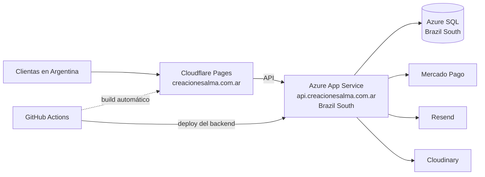

# Creaciones Alma — tienda online de papelería creativa

Tienda online completa para un emprendimiento de **papelería creativa** de Marcos Paz, Argentina: fotos Polaroid, stickers, álbumes e impresiones personalizadas. Incluye la tienda para las clientas, un **panel de administración** para manejar todo el negocio, y está publicada en producción con infraestructura pensada para clientas de Argentina.

🌐 **Sitio:** [creacionesalma.com.ar](https://creacionesalma.com.ar) — hoy en modo *próximamente* mientras se carga el catálogo.

> Repositorio publicado como muestra de portfolio. El desarrollo y los deploys se hacen desde un repositorio privado.

---

## Qué tiene

### Para las clientas
- **Catálogo** con categorías, buscador, filtros y ficha de producto con galería de fotos.
- **Ofertas** con precio tachado y porcentaje de descuento, y **cupones** de descuento en el checkout.
- **Compras por ocasión** (cumpleaños, Día de la Madre, aniversarios…) y página de regalos.
- **Checkout** con envío a domicilio o retiro, pago con **Mercado Pago** o transferencia (con descuento), compra como invitada o con cuenta.
- **Seguimiento de pedidos**, cuenta de usuaria, verificación de email y recuperación de contraseña.
- **Newsletter** con cupón de bienvenida personal y baja en un clic.
- Galería de trabajos con visor a pantalla completa, testimonios y consulta por **WhatsApp**.
- **Páginas legales argentinas:** términos, privacidad, cambios y devoluciones, defensa del consumidor y **botón de arrepentimiento** (Ley 24.240).

### Panel de administración
- **Dashboard** con gráficos de ventas, visitas, clientes, productos más y menos vendidos y calificaciones.
- **Costos y facturación**: ingresos, pendientes, meta mensual, top de clientes y exportación a CSV.
- **Pedidos** con filtros por estado y número de seguimiento; avisos por mail a la clienta.
- **Productos y ofertas** con varias fotos (subida firmada a Cloudinary) y aviso de **stock bajo**.
- Categorías, ocasiones, galería, cupones, suscriptores, testimonios, usuarios y roles, arrepentimientos.
- **Modo próximamente**: con un botón se cierra la tienda al público mientras se carga el catálogo; solo los administradores la ven.
- Menú lateral plegable, contadores de pendientes y diseño adaptado a celular.

---

## Decisiones técnicas que me interesa destacar

- **Pensado para Argentina:** backend y base en **San Pablo** (Azure Brazil South) y la tienda servida desde el borde de Cloudflare en Buenos Aires. Medido desde Buenos Aires: **~80 ms por consulta**, contra ~300 ms con el backend en EE.UU.
- **Seguridad:**
  - el total de la compra siempre se calcula en el servidor;
  - JWT validado contra la base en cada pedido (una cuenta bloqueada o un rol cambiado se aplica al instante);
  - `helmet`, CORS restringido y límites de pedidos por IP (login, recuperación, checkout, cupones, newsletter);
  - errores genéricos al cliente;
  - usuario de base con permisos mínimos (solo lectura y escritura de datos).
- **Tienda cerrada de verdad:** en modo próximamente la API rechaza todo salvo una lista mínima (login, recuperación, newsletter, webhook de pagos), así un curioso no puede ver el catálogo aunque llame a la API directo. El front confirma el rol con el backend en vez de confiar en lo guardado en el navegador.
- **Fechas en UTC** en la base y agrupación por día en horario de Argentina.
- **SEO:** títulos, descripciones, canonical y datos estructurados por página; `sitemap.xml` y `robots.txt` generados en el build; `noindex` mientras la tienda está cerrada.
- **Rendimiento:**
  - las páginas que no son el inicio se cargan bajo demanda;
  - de Bootstrap se importan solo los componentes usados;
  - los gráficos (ECharts) se descargan solo en el panel;
  - la configuración se guarda en el navegador para que la página arranque sin esperar al backend.
- **Mails con dominio propio** (Resend) con plantillas con la marca.
- **Analítica opcional** (GA4 / píxel de Meta) que no carga ningún script de terceros si no está configurada; la política de privacidad se adapta sola.

---

## Stack

| Parte | Tecnologías |
|---|---|
| Frontend | Vue 3 (`<script setup>`), Vite, Vue Router, Pinia, Bootstrap 5, Bootstrap Icons, ECharts |
| Backend | Node.js, Express 5, `mssql`, JWT, bcrypt, helmet, express-rate-limit |
| Base de datos | SQL Server (Azure SQL Database en producción) |
| Servicios | Mercado Pago, Resend (mails), Cloudinary (imágenes), Correo Argentino (envíos) |
| Infraestructura | Cloudflare Pages + DNS, Azure App Service (Linux), GitHub Actions |

## Arquitectura



## Estructura

```
backend/
  routes/        Endpoints de la API (productos, órdenes, cupones, newsletter, admin…)
  middleware/    Autenticación, límites de pedidos y modo próximamente
  utils/         Precios y cupones, mails, fechas, Correo Argentino
  sql/           Esquema completo, datos iniciales y migraciones
  scripts/       Crear la base y el primer administrador
frontend/
  src/views/     Páginas de la tienda y del panel
  src/components/
  src/stores/    Estado (carrito, sesión, configuración)
.github/workflows/  Deploy del backend a Azure
DEPLOY.md           Guía paso a paso del deploy en producción
```

## Correrlo en local

Requisitos: Node.js 22 y un SQL Server (sirve SQL Server Express o Developer).

```bash
# Backend
cd backend
cp .env.example .env        # completar los datos de la base y las claves de los servicios
npm install
node scripts/preparar-base.js   # crea las tablas y los datos iniciales
node scripts/crear-admin.js     # crea el primer administrador
npm run dev                     # http://localhost:3000

# Frontend (en otra terminal)
cd frontend
cp .env.example .env.local
npm install
npm run dev                     # http://localhost:5173
```

La guía completa de producción está en [DEPLOY.md](DEPLOY.md).

---

**Autor:** Lucas Correa · Diseño, desarrollo y puesta en producción.

© 2026 Lucas Correa. Todos los derechos reservados. El código se publica como muestra de trabajo; la marca, los textos y las imágenes pertenecen a Creaciones Alma.
